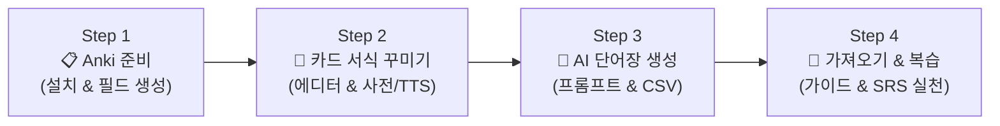
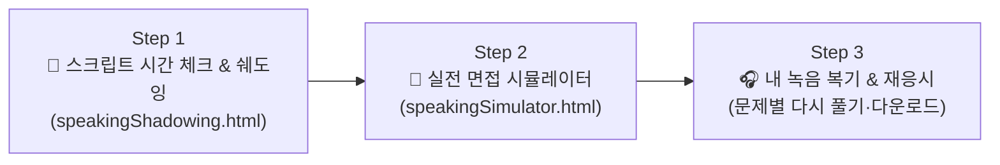

# 🌄 Study with Wanzi - 다국어 Anki & 말하기 시험 학습 도구 모음

> **"누구나 쉽게 쓰는 나만의 Anki 단어장 & 말하기 시험(OPIc·토스·면접) 실전 훈련소"**  
> 비개발자도 10분 만에 끝내는 Anki 카드 서식·AI 단어장 생성부터, 답변 스크립트 쉐도잉 스튜디오와 실전 면접 시뮬레이터까지 — 별도 설치나 회원가입 없이 브라우저에서 바로 사용하는 무료 어학 학습 웹 툴킷입니다.

[](https://wanzi-study.github.io/studyWithWanzi/)
[](LICENSE)
[](#-기술-스택-및-설계-철학)
[](#-다국어-i18n-지원)

---

## 📖 프로젝트 배경 (Why Study with Wanzi?)

**Study with Wanzi**는 외국어 학습자들이 겪는 번거로움을 줄이고 오직 공부에만 집중할 수 있도록 돕기 위해 시작되었습니다. 사이트 전반의 모든 화면과 문구는 **비개발자도 설명서 없이 직관적으로 다룰 수 있는 친절한 UX**를 지향합니다.

1. **🃏 Anki(안키) 단어 학습 도구 — 비개발자에게 불친절한 조작 방식 해결**
   * Anki는 세계 최고의 간격 반복(SRS) 암기 앱이지만, 카드를 꾸미려면 HTML/CSS와 `{{Field}}` 문법을 직접 다뤄야 하고 CSV 파일을 가져올 때 UTF-8 인코딩이나 칸 구분 문제로 글자가 깨지는 등 비개발자에게 진입 장벽이 높습니다.
   * Study with Wanzi는 코딩 없이 버튼 몇 번으로 사전 링크·TTS가 달린 카드를 꾸미고, AI 답변을 Anki용 CSV 파일로 즉시 변환해 줍니다.
2. **🎙️ 말하기 시험 연습 도구 — 스크립트 체화부터 실전 모의면접까지 올인원 대비**
   * OPIc, 토익스피킹, HSKK, 관광통역안내사 면접 등을 독학할 때는 내가 쓴 답변 스크립트가 제한 시간(60초·90초·120초)에 맞는지 확인하며 입에 붙이는 **쉐도잉 훈련**과, 실제 시험장처럼 무작위 질문을 듣고 제한 시간 안에 대답해 보는 **실전 시뮬레이션**이 모두 필요합니다.
   * Study with Wanzi는 유료 앱이나 외부 API 없이 브라우저 내장 음성 합성(TTS)과 녹음 기능만으로 스크립트 훈련과 실전 모의고사를 한곳에서 제공합니다.

---

## 🧭 2대 학습 도구 모음 (Two Main Suites)

상단 헤더의 **`🃏 Anki 도구 ▾`** 와 **`🎙️ 말하기 도구 ▾`** 드롭다운 메뉴를 통해 언제든 원하는 도구로 이동할 수 있습니다.

### 🃏 Part 1. Anki 단어 학습 도구 모음 (`/anki/`)



1. **🌄 Anki 카드 서식 에디터 (`anki/ankiEditor.html`)**
   * **46개 언어 공식 네이버 사전 원클릭 매핑**: 단어 옆에 `🌐 외국어사전`, `📘 국어사전` 아이콘 자동 삽입
   * **Anki 내장 음성 재생 (TTS)**: `{{tts lang:Field}}` 태그 및 속도 설정 자동 생성
   * **감성 & 전통 디자인 테마**: 기본, 링 단어장, 스티키 메모, 포레스트, 한지, 오방색, 일월오봉도, 단청, 자개 등 20여 종 테마와 실시간 앞/뒷면·다크모드 미리보기
2. **🤖 Anki AI 프롬프트 생성기 (`anki/ankiPrompt.html`)**
   * **어학 시험 급수별 정밀 필터링**: 토익/토플, JLPT(N1~N5), HSK(1~6급), CEFR(A1~C2) 등 맞춤형 프롬프트 생성
   * **스마트 CSV 변환기**: AI 답변의 인사말·마크다운 블록을 자동 제거하고 UTF-8 BOM + Anki 메타 헤더(`#separator:Comma`, `#html:true`)가 포함된 CSV 파일 즉시 생성
3. **📖 Anki 가이드 (`anki/ankiGuide.html`) & ❓ 사용 설명서 (`anki/ankiManual.html`)**
   * 설치부터 필드 생성, 서식 복사, CSV 가져오기, 매일 복습하는 법까지 스크린샷으로 안내하는 4단계 가이드와 도구 화면별 상세 매뉴얼/FAQ 수록

---

### 🎙️ Part 2. 말하기 시험 연습 도구 모음 (`/speaking/`)



1. **📜 스크립트 쉐도잉 스튜디오 (`speaking/speakingShadowing.html`)**
   * **예상 발화 시간 & 목표 시험 시간 게이지**: 스크립트를 붙여넣으면 문장 단위로 쪼개어 배속 기준 예상 발화 시간(초)을 계산하고, 목표 시간(30초/45초/60초/90초/120초) 대비 적정/초과 여부를 시각 게이지로 표시
   * **문장 사이 따라 말할 쉼 시간 (Auto 지원)**: 원어민 TTS가 한 문장을 읽은 직후, 그 문장 길이에 비례해 내가 따라 말할 시간만큼 자동으로 기다려 주며 카운트다운 바 표시
   * **3단계 암기 가림막 (블러 모드)**: `모두 보기` ➔ `외국어만 가리기 (한국어 해석 줄만 보고 즉시 외국어로 입 열기)` ➔ `전체 가리기 (청각 쉐도잉)`
   * **1문장 무한 루프(🔂) & 최대 재생 타이머(⏲️)**: 안 외워지는 문장만 집중 반복하거나, 5분~60분 슬립 타이머 설정 가능
   * **🎤 내 발음 녹음 & 원어민 시간 비교**: 내가 말한 음성을 녹음해 바로 들어보고 `원어민 ~4.2초 vs 나 4.5초`처럼 발화 속도감을 비교

2. **🎯 실전 면접 시뮬레이터 (`speaking/speakingSimulator.html`)**
   * **엑셀/메모장 여러 줄 한 번에 붙여넣기**: 줄바꿈 단위로 질문을 자동 인식하고 앞 번호(`1.`, `Q1:`)를 깔끔하게 정리
   * **실전 타이머 & 질문 블라인드 모드**: 문제 텍스트를 가린 채 원어민 음성으로만 질문을 듣고, 답변 제한 시간 카운트다운과 종료 알림음(Web Audio API 합성 비프음 4종)으로 실전 감각 훈련
   * **내 답변 녹음 & 문제별 다시 풀기**: 시험 종료 후 문제별 소요 시간과 내 녹음을 바로 들어보고, 아쉬운 문제만 골라 즉시 재응시하거나 오디오 파일로 다운로드

3. **🌐 모국어 + 외국어 1:1 음성 자동 감지 & 브라우저별 안내**
   * 한 줄에 한국어와 외국어가 섞여 있어도 **내 모국어 + 선택한 외국어 1개**만 1:1로 매칭하여 한자(중국어↔일본어)나 로마자(영어↔스페인어/프랑스어) 혼동 없이 각 구간의 원어민 음성으로 자연스럽게 교차 낭독
   * 브라우저별(Edge · Chrome · Safari · Whale) 지원 음성과 고품질 음성 추가 방법을 안내하는 `ⓘ 브라우저별 음성 안내` 팝오버 및 전용 설명서(`speaking/speakingManual.html`) 제공

---

## 🛠️ 기술 스택 및 설계 철학

| 영역 | 사용 기술 및 방식 | 비고 |
|:---|:---|:---|
| **Frontend** | HTML5, CSS3, Vanilla JavaScript (ES6+) | 빌드/번들러 없는 순수 웹 표준 |
| **Speech & Audio** | Web Speech API (`speechSynthesis`), Web Audio API, `MediaRecorder` | 외부 유료 API 없이 100% 브라우저 내장 처리 |
| **Styling** | Modern CSS Variables, Flexbox/Grid, CSS Theme Engine | 경량화 및 PC/모바일 반응형 |
| **Storage** | Client-side `localStorage` | 서버 없음, 녹음·스크립트 외부 전송 전혀 없음 |
| **i18n** | 자체 경량 다국어 라우터 & 2대 대분류 드롭다운 네비게이션 (`assets/js/i18n.js`) | 한국어(ko), 영어(en), 중국어(zh) |
| **Hosting** | GitHub Pages (정적 호스팅) | 어디서나 접속 가능한 완전 무료 배포 |

---

## 📁 프로젝트 폴더 구조

```text
studyWithWanzi/
├── index.html                        # 루트 메인 허브 (Anki 도구 & 말하기 도구 2대 기둥 포털)
├── ankiEditor.html                   # 루트 호환용 리다이렉트 스텁 (→ anki/ankiEditor.html)
├── ankiPrompt.html                   # 루트 호환용 리다이렉트 스텁 (→ anki/ankiPrompt.html)
├── ankiGuide.html                    # 루트 호환용 리다이렉트 스텁 (→ anki/ankiGuide.html)
├── ankiManual.html                   # 루트 호환용 리다이렉트 스텁 (→ anki/ankiManual.html)
├── README.md                         # 프로젝트 안내 문서
├── VIBE_CODING.md                    # AI 바이브 코딩 및 유지보수를 위한 가이드 문서
│
├── anki/                             # 🃏 Anki 단어 학습 도구 모음
│   ├── index.html                    # Anki 도구 허브 (4단계 시작 경로 및 도구 바로가기)
│   ├── ankiEditor.html               # Anki 카드 서식 에디터 (스타일, 테마, 사전/TTS)
│   ├── ankiPrompt.html               # Anki AI 프롬프트 생성기 (난이도 선택 및 CSV 변환)
│   ├── ankiGuide.html                # Anki 4단계 가이드 (설치부터 복습까지)
│   └── ankiManual.html               # Anki 도구 사용 설명서 & 자주 묻는 질문(FAQ)
│
├── speaking/                         # 🎙️ 말하기 시험 연습 도구 모음
│   ├── index.html                    # 말하기 도구 허브 (3단계 연습 경로 및 도구 바로가기)
│   ├── speakingSimulator.html        # 🎯 실전 면접 시뮬레이터 (무작위 질문·타이머·녹음)
│   ├── speakingShadowing.html        # 📜 스크립트 쉐도잉 스튜디오 (발화시간·배속·암기블러)
│   └── speakingManual.html           # ❓ 말하기 연습 사용 설명서 & 자주 묻는 질문(FAQ)
│
└── assets/
    ├── css/
    │   ├── style.css                 # 공통 테마, 2대 대분류 드롭다운 헤더, 반응형 레이아웃
    │   ├── index.css                 # 허브 포털 전용 스타일
    │   ├── editor.css                # Anki 에디터 전용 컴포넌트 & 인스펙터 스타일
    │   ├── prompt.css                # AI 프롬프트 생성기 & CSV 다운로드 스타일
    │   ├── guide.css                 # 가이드북 & 사용 설명서(FAQ) 전용 스타일
    │   └── speaking.css              # 말하기 시뮬레이터 & 쉐도잉 스튜디오 전용 스타일
    │
    ├── js/
    │   ├── languages.js              # 46개 언어 메타데이터 및 공식 사전 링크 매핑
    │   ├── langCombobox.js           # 초성 검색 및 별칭 지원 언어 선택 콤보박스
    │   ├── i18n.js                   # 다국어(ko/en/zh) 렌더링 및 상단 드롭다운 네비게이션 엔진
    │   ├── app.js                    # Anki 카드 서식 에디터 메인 로직
    │   ├── promptApp.js              # Anki AI 프롬프트 생성기 & CSV 파서 로직
    │   └── speakingApp.js            # 말하기 시뮬레이터 & 쉐도잉 스튜디오 통합 엔진
    │
    ├── i18n/                         # 다국어 번역 사전 (ko / en / zh)
    │   └── {ko,en,zh}/{common,index,editor,prompt,guide,manual}.js
    │
    └── images/
        └── guide/                    # Anki 가이드 스크린샷 이미지
```

---

## 💻 실행 및 배포 방법

1. **로컬 실행 (VS Code Live Server / Python HTTP 서버)**
   * 터미널에서 `python -m http.server 8000` 실행 후 `http://localhost:8000` 접속 (또는 `index.html` 직접 열기)
2. **온라인 웹 접속 (GitHub Pages)**
   * [https://wanzi-study.github.io/studyWithWanzi/](https://wanzi-study.github.io/studyWithWanzi/)

---

## 🤝 기여 및 유지보수 안내

* AI 기반 바이브 코딩(Vibe Coding)으로 본 프로젝트를 수정하거나 확장하려는 분은 **[`VIBE_CODING.md`](VIBE_CODING.md)** 문서를 반드시 먼저 확인해 주세요.

## 📄 라이선스

이 프로젝트는 [MIT License](LICENSE)에 따라 자유롭게 사용 및 수정할 수 있습니다.  
Made with care for language learners. © 2026 Study with Wanzi.
